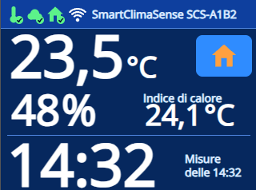
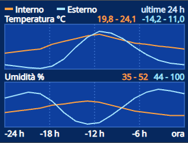
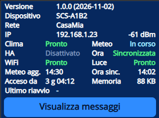

*SmartClimaSenseNG: a climate station for Home Assistant, and my first complete project led by artificial intelligence*

---

## From a DIY idea to a new generation

It all started, years ago, with a very concrete need: knowing precisely what the climate is like at home and using that data to make the heating work better through **Home Assistant**. As a "do-it-yourself" (DIY) electronics enthusiast, I had built the first version by hand: a microcontroller, a few sensors, and plenty of code written in the evenings and on weekends.

**SmartClimaSenseNG**, where *NG* stands for *New Generation*, is its evolution. The goal is the same, but I radically changed the way I get there: **I didn't write even a single line of code**. I did what I do every day as a consultant: I led a project. The team, however, was made up of artificial intelligence agents.

## The product

SmartClimaSenseNG is a **desktop climate station** based on ESP32, with a 320×240 color touch display (AZ-Touch board). In practice:

- it **measures temperature, humidity and heat index** of the room, plus the light level to adjust the screen brightness on its own. At night it stays at minimum and doesn't light up the room;
- it **shows the outdoor weather** (temperature, humidity and conditions with day and night icons), taken from a public weather service for the configured location;
- it offers a **24-hour chart**, an **Info** screen with the status of each module (sensors, WiFi, time, weather, Home Assistant) and a **messages** inbox with warnings and errors;
- it **integrates with Home Assistant** via MQTT with automatic discovery: the measurements become entities ready for automations, such as heating management;
- it is **configured from your smartphone**: at first boot it shows a QR code, you connect to its network and open the configuration portal (WiFi, location, time zone, Home Assistant). Before that, a short five-point touch calibration.

I designed it as an object to keep at home and read "from a distance": big digits, colors that tell you at a glance if something is wrong, no maintenance.

The images below come from the mockup prepared by the UI designer agent during the solution analysis phase: they are not screenshots of the real app, but they give a very realistic picture of it.

  
*The Main screen, indoor view: temperature, humidity, heat index and time.*

  
*The 24-hour chart: temperature and humidity, indoor and outdoor.*

  
*The Info screen: the status of sensors, WiFi, time, weather and Home Assistant.*

## The AI context: a team, not a chatbot

The part I'm most interested in telling is **how** the product came to be.

I didn't use AI as an assistant to ask for pieces of code. With Claude Code, I built a small **team of specialized agents**, each with its own role and limits:

- an **analyst** for the functional specifications;
- an **architect** for architecture, interfaces, memory and technical decisions;
- a **UI designer** for the visual system, mockups and verification of user requirements;
- a **test designer**, the only one authorized to write tests;
- separate **developers** for firmware, interface and web portal (the web page for setting up and configuring the device);
- an independent **tester** and **reviewer**.

Above them sits an **orchestrator**, the AI "project lead" I talked to. It distributed the work, brought me the agents' questions and recorded every decision.

A few rules made the difference:

- **Delivery in four classic phases**: specifications, architecture, code, build and test. You move on to the next phase **only with my explicit approval**, after a formal review (a "gate").
- **No inventions**: if a requirement is ambiguous, the agent stops and asks a question. Every question and every answer ends up in a numbered log. To date there are over **250 tracked decisions**, each with options, a recommendation and the final choice.
- **Tests before code**: functional tests are written from the requirements, before implementation. Today over **600 run on the PC** thanks to a device simulator, plus tests on the real board.
- **The right model for each task**: mechanical tasks go to a lightweight model, drafting to a mid-range one, decisions and reviews to the most capable. It's also a matter of cost and efficiency, as in a real team.
- **Traceability**: requirement, decision, component and test are always linked. Any change to an already approved requirement reopens only the parts it touches, and leaves a trace of what changed and why.

## My role: deciding

My job was that of **product owner and project manager**:

- I defined the vision;
- I answered the questions;
- I chose among the proposed options;
- I tried the device and reported what I saw.

A few examples of how it went in practice:

- **The color palette** I chose by looking at the real display, among variants the agents prepared for the purpose, and I asked for a "brighter" red for errors.
- **Memory**: on the real board, the free RAM was half of what the architecture had estimated. The agents measured every phase of the boot, found the causes, proposed remedies with costs and benefits, and after my choices the free memory went from about 63 to 90 KB.
- **The captive portal** wouldn't open on a Samsung smartphone. From the logs we figured out that the phone "distrusted" our DNS. The final solution was tested on Android, iPhone and Windows.
- **Touch responsiveness** is measured with automated tests: today the response to a touch starts in about 20 milliseconds.

Every time the dynamic was the same: **the AI analyzes, measures and proposes; I decide**.

## What I bring into my profession

As an IT consultant, this experience left me with very concrete skills:

1. **Designing a process for AI agents**: roles, boundaries, escalation rules, quality criteria. It's process engineering, not "magic prompts".
2. **Governance and traceability**: with AI the speed is enormous. Without a log of decisions and gates, you lose control within days.
3. **Classic methodology still works, even more so**: requirements, architecture, tests before code, independent review. AI doesn't make it superfluous: it makes it sustainable even for a single person.
4. **Value shifts to decisions**: choosing between alternatives, accepting conscious trade-offs (memory versus features, contrast versus aesthetics) and verifying in the field.
5. **Cost is a project variable**: choosing the right model for each task and managing a usage budget is part of planning.

## Where we are

The project is in the **advanced development phase**:

- all screens are implemented and the device is running on my desk;
- what's left are the final measurements, the code cleanup and the final build and test phase.

The journey, however, is already the most interesting part to tell.

If you work in IT and wonder how to take AI beyond "code completion", all the way to delivering a product, get in touch: I'm happy to talk about it.

*— Giovanni Petrillo, [giopet.dev](https://giopet.dev)*
