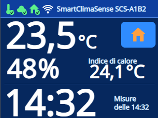
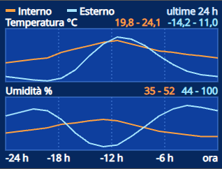
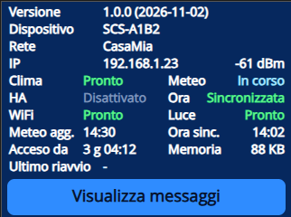

*SmartClimaSenseNG: una stazione climatica per Home Assistant, e il mio primo progetto completo guidato dall'intelligenza artificiale*

---

## Da un'idea "fai da te" a una nuova generazione

Tutto è partito, anni fa, da un'esigenza molto concreta: sapere con precisione che clima c'è in casa e usare quei dati per far lavorare meglio il riscaldamento tramite **Home Assistant**. Da appassionato di elettronica "fai da te" (DIY) avevo costruito la prima versione a mano: un microcontrollore, qualche sensore, tanto codice scritto la sera e anche durante i week-end.

**SmartClimaSenseNG**, dove *NG* sta per *New Generation*, è la sua evoluzione. È lo stesso obiettivo, ma ho cambiato radicalmente il modo di arrivarci: **non ho scritto nemmeno una riga di codice**. Ho fatto quello che faccio ogni giorno come consulente: ho guidato un progetto. Il team però era fatto di agenti di intelligenza artificiale.

## Il prodotto

SmartClimaSenseNG è una **stazione climatica da tavolo** basata su ESP32, con un display touch a colori da 320×240 (scheda AZ-Touch). In pratica:

- **misura temperatura, umidità e indice di calore** dell'ambiente, e la luce per regolare da sola la luminosità dello schermo. Di notte resta al minimo e non illumina la stanza;
- **mostra il meteo esterno** (temperatura, umidità e condizione con icone giorno e notte), preso da un servizio meteo pubblico per la posizione configurata;
- offre un **grafico delle ultime 24 ore**, una schermata **Info** con lo stato di ogni modulo (sensori, WiFi, ora, meteo, Home Assistant) e una casella dei **messaggi** con avvisi ed errori;
- **si integra con Home Assistant** via MQTT con discovery automatica: le misure diventano entità pronte per automazioni, come la gestione del riscaldamento;
- **si configura dallo smartphone**: al primo avvio mostra un codice QR, ci si collega alla sua rete e si apre il portale di configurazione (WiFi, posizione, fuso orario, Home Assistant). Prima, una breve calibrazione del touch a cinque punti.

L'ho pensato come un oggetto da tenere in casa e leggere "da lontano": cifre grandi, colori che dicono subito se qualcosa non va, nessuna manutenzione.

*La schermata Principale, vista interna: temperatura, umidità, indice di calore e ora.*

*Il grafico delle ultime 24 ore: temperatura e umidità, interne ed esterne.*

*La schermata Info: lo stato di sensori, WiFi, ora, meteo e Home Assistant.*

## Il contesto AI: un team, non un chatbot

La parte che mi interessa di più raccontare è **come** il prodotto è nato.

Non ho usato l'AI come un assistente a cui chiedere pezzi di codice. Ho costruito, con Claude Code, un piccolo **team di agenti specializzati**, ognuno con il suo ruolo e i suoi limiti:

- un **analista** per le specifiche funzionali;
- un **architetto** per architettura, interfacce, memoria e decisioni tecniche;
- un **designer UI** per sistema visivo, mockup e verifica dei requisiti utente;
- un **progettista dei test**, l'unico autorizzato a scrivere test;
- **sviluppatori** separati per firmware, interfaccia e portale web (la pagina web per il setup e la configurazione del dispositivo);
- un **tester** e un **revisore** indipendente.

Sopra di loro c'è un **orchestratore**, il "capo progetto" AI con cui parlavo io. Distribuiva il lavoro, portava a me le domande degli agenti e registrava ogni decisione.

Alcune regole hanno fatto la differenza:

- **Delivery in quattro fasi classiche**: specifiche, architettura, codice, build e test. Si passa alla fase successiva **solo con la mia approvazione esplicita**, dopo una revisione formale ("gate").
- **Niente invenzioni**: se un requisito è ambiguo, l'agente si ferma e fa una domanda. Ogni domanda e ogni risposta finisce in un registro numerato. A oggi sono oltre **250 decisioni tracciate**, ciascuna con opzioni, raccomandazione e scelta finale.
- **Test prima del codice**: i test funzionali sono scritti a partire dai requisiti, prima dell'implementazione. Oggi ne girano oltre **600 sul PC** grazie a un simulatore del dispositivo, più i test sulla scheda reale.
- **Il modello giusto per ogni compito**: compiti meccanici a un modello leggero, redazione a uno intermedio, decisioni e revisioni al più capace. È anche una questione di costi e di efficienza, come in un team vero.
- **Tracciabilità**: requisito, decisione, componente e test sono sempre collegati. Ogni modifica a un requisito già approvato riapre solo le parti toccate, e lascia traccia di cosa è cambiato e perché.

## Il mio ruolo: decidere

Il mio lavoro è stato quello del **product owner e project manager**:

- ho definito la visione;
- ho risposto alle domande;
- ho scelto tra le opzioni proposte;
- ho provato il dispositivo e riportato quello che vedevo.

Qualche esempio di come è andata nella pratica:

- **La palette dei colori** l'ho scelta guardando il display vero, tra varianti preparate apposta dagli agenti, e ho chiesto un rosso "più acceso" per gli errori.
- **La memoria**: sulla scheda reale la RAM libera era la metà di quella stimata in architettura. Gli agenti hanno misurato ogni fase dell'avvio, trovato le cause, proposto i rimedi con costi e benefici, e dopo le mie scelte la memoria libera è passata da circa 63 a 90 KB.
- **Il captive portal** non si apriva su uno smartphone Samsung. Dai log abbiamo capito che il telefono "diffidava" del nostro DNS. La soluzione finale è stata provata su Android, iPhone e Windows.
- **La reattività** del touch è misurata con test automatici: oggi la risposta al tocco parte in circa 20 millisecondi.

Ogni volta la dinamica era la stessa: **l'AI analizza, misura e propone; io decido**.

## Cosa mi porto nella professione

Da consulente informatico, questa esperienza mi ha lasciato competenze molto concrete:

1. **Progettare un processo per agenti AI**: ruoli, confini, regole di escalation, criteri di qualità. È ingegneria del processo, non "prompt magici".
2. **Governance e tracciabilità**: con l'AI la velocità è enorme. Senza un registro delle decisioni e dei gate, si perde il controllo in pochi giorni.
3. **La metodologia classica funziona ancora, anzi di più**: requisiti, architettura, test prima del codice, revisione indipendente. L'AI non la rende superflua: la rende sostenibile anche per una persona sola.
4. **Il valore si sposta sulle decisioni**: scegliere tra alternative, accettare compromessi consapevoli (memoria contro funzionalità, contrasto contro estetica) e verificare sul campo.
5. **Il costo è una variabile di progetto**: scegliere il modello giusto per ogni compito e gestire un budget di utilizzo fa parte della pianificazione.

## A che punto siamo

Il progetto è nella **fase di sviluppo avanzata**:

- tutte le schermate sono implementate e il dispositivo gira sul mio tavolo;
- restano le ultime misure, la pulizia del codice e la fase finale di build e test.

Il percorso, comunque, è già la parte più interessante da raccontare.

Se lavori nell'IT e ti stai chiedendo come portare l'AI oltre il "completamento del codice", fino alla consegna di un prodotto, scrivimi: ne parlo volentieri.

*— Giovanni Petrillo, [giopet.dev](https://giopet.dev)*
